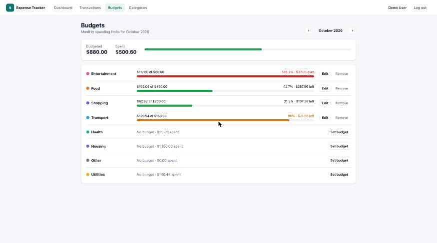
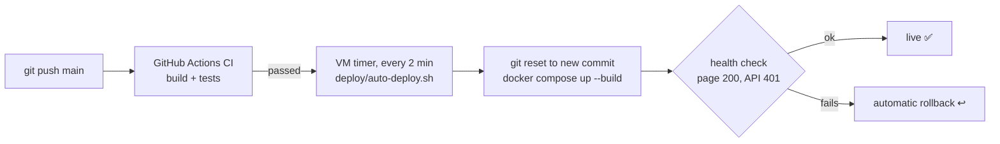

# Expense Tracker

**🔗 Live demo: [expense-tracker.edsuelila.dev](https://expense-tracker.edsuelila.dev)**: log in with `demo@example.com`, password `password123`.
The demo accounts are shared by all visitors, so data you see may have been changed by someone else.

A full-stack personal finance app: record income and expenses, group them into color-coded categories, set monthly budgets per category, and see where the money goes on a dashboard with charts. The backend is a **Spring Boot 3 REST API** secured with **JWT**, storing data in **PostgreSQL** (H2 in development) with **Flyway** migrations. The frontend is an **Angular 17** single-page app built with standalone components, signals and reactive forms, with charts from **Chart.js**. Both halves have automated tests, Docker images and a GitHub Actions CI pipeline.

> New to the codebase? Read the guide: **[docs/HOW-IT-WORKS.md](docs/HOW-IT-WORKS.md)**. It walks through the architecture, one request from click to database, security, the data model, every API endpoint and the design decisions. The source code is also heavily commented for learning.

## Features

- **Accounts**: register and log in (BCrypt-hashed passwords, stateless JWT authentication). New accounts get 9 starter categories.
- **Transactions**: create, edit and delete income and expense entries. Filter by month, type, category and description text, sort by date/amount/description, paginated server-side. Amounts are color-coded (+ green / − red).
- **Categories**: name, color and type (expense or income). Names are unique per user. A category that still has transactions cannot be deleted (HTTP 409 with a clear message).
- **Budgets**: a monthly limit per expense category, set inline. Progress bars turn **amber above 80%** and **red above 100%**.
- **Dashboard**: month picker; income, expenses, balance and savings-rate cards; spending-by-category doughnut; 6-month income-vs-expense bar chart; daily-spending line chart; budget progress; recent transactions.
- **Business rules enforced on the server**: amounts > 0 with at most 2 decimals, no future dates, transaction type must match category type, budgets only on expense categories, and every record visible only to its owner (another user's ids return 404).
- **Swagger UI** at `/swagger-ui.html`, a **demo account** with 3 months of realistic data, **Docker Compose** for the whole stack, **CI** on every push.

## Tech stack

| Layer | Technology |
|---|---|
| Backend | Java 17, Spring Boot 3.5 (Web, Data JPA, Validation, Security), Hibernate 6, jjwt 0.12 |
| Database | PostgreSQL 16 (production), H2 in PostgreSQL mode (development and tests), Flyway migrations |
| Frontend | Angular 17 (standalone components, signals, reactive forms, new `@if`/`@for` control flow), TypeScript, SCSS, Chart.js 4 |
| Testing | JUnit 5, Mockito, AssertJ, Spring MockMvc; Jasmine and Karma (headless Chrome) |
| Delivery | Docker multi-stage builds, nginx, Docker Compose, GitHub Actions |

## Quick start

### Option A: run locally (no database to install)

Requirements: Java 17+, Node 18+.

```bash
# Terminal 1: API on http://localhost:8082 (in-memory H2 database, demo data seeded)
cd backend
./mvnw spring-boot:run

# Terminal 2: web app on http://localhost:4302 (/api calls are proxied to :8082)
cd frontend
npm install
npm start
```

Open **http://localhost:4302** and click **"Use the demo account"**.

Also available in development: Swagger UI at http://localhost:8082/swagger-ui.html and the H2 console at http://localhost:8082/h2-console (JDBC URL `jdbc:h2:mem:expensetracker`, user `sa`, empty password).

> Always use the Maven wrapper `./mvnw` (it pins the Maven version) rather than a globally installed `mvn`.

### Option B: Docker (PostgreSQL + API + nginx)

```bash
docker compose up --build
```

Open **http://localhost:8092**. Data is kept in a Docker volume; `docker compose down -v` removes it.

### Run the tests

```bash
cd backend && ./mvnw -B verify                                         # 26 unit + integration tests
cd frontend && npx ng test --watch=false --browsers=ChromeHeadless      # 14 Jasmine specs
```

## Running in IntelliJ IDEA or VS Code

Both editors work. The repo includes ready-made run configurations for each one
(`.run/` for IntelliJ, `.vscode/` for VS Code), so you don't have to set anything up by hand.

**You need:** JDK 17+, Node.js 18+ (Angular 17 requires 18.13 or newer) and npm. You don't need Maven:
the project uses the Maven Wrapper (`mvnw`).

| | Backend (Spring Boot API) | Frontend (Angular) |
|---|---|---|
| URL | http://localhost:8082 (Swagger: `/swagger-ui.html`) | http://localhost:4302 |
| Entry point | `backend/src/main/java/com/portfolio/expensetracker/ExpenseTrackerApplication.java` | `frontend/` → `npm start` |

Start the **backend first**, then the frontend. The frontend dev server forwards `/api` calls to port 8082.
Then open http://localhost:4302 and click **Use the demo account** (`demo@example.com` / `password123`).

### IntelliJ IDEA (Community or Ultimate)

1. **Open the project:** *File → Open…* and select the **repository root folder** (the one containing `backend/` and `frontend/`).
   If IntelliJ doesn't import Maven automatically, right-click `backend/pom.xml` → **Add as Maven Project**.
2. **Set the JDK:** *File → Project Structure → Project → SDK* → choose a **17** (or newer) JDK.
   If none is listed, use *Add SDK → Download JDK* (for example Eclipse Temurin 17).
3. **Use the Maven Wrapper:** *Settings → Build, Execution, Deployment → Build Tools → Maven* → **Maven home path: Use Maven wrapper**.
4. **Run the backend:** choose **Backend (Spring Boot)** in the run-configuration dropdown (top right) and click ▶ Run or 🐞 Debug.
   Or open `ExpenseTrackerApplication.java` and click the green ▶ next to `main`. Wait for `Started ExpenseTrackerApplication in … seconds` in the console.
5. **Run the frontend:**
   - **Ultimate:** choose the **Frontend (npm start)** run configuration and click ▶. The first time, right-click `frontend/package.json` → **Run 'npm install'**.
   - **Community** (no JavaScript support): open the **Terminal** tool window and run:
     ```bash
     cd frontend
     npm install   # first time only
     npm start
     ```
6. **Run the tests:** choose the **Backend tests** configuration, or right-click `backend/src/test/java` → **Run 'All Tests'**.
   Frontend tests run in the terminal: `cd frontend && npx ng test --watch=false --browsers=ChromeHeadless`.

> **Tip:** in Ultimate, the *Services* tool window shows the Spring Boot app with its endpoints and health.
> To debug, set breakpoints in a controller or service and start **Backend (Spring Boot)** with 🐞 Debug.

### VS Code

1. **Open the folder:** *File → Open Folder…* and select the **repository root**.
2. **Install the recommended extensions** when VS Code prompts you (they're listed in `.vscode/extensions.json`):
   - **Extension Pack for Java**: Java language support, Maven, debugger, test runner
   - **Spring Boot Extension Pack**: Spring Boot tools + Spring Boot Dashboard
   - **Angular Language Service**: template autocompletion and errors

   When the Java extension asks, choose **Trust** and let it import the Maven project
   (the status bar shows "Java: Ready" when it's done).
3. **Run everything with one click:** open *Run and Debug* (Ctrl/Cmd + Shift + D), pick
   **Full stack (backend + frontend)** and press ▶. This starts the Spring Boot API with the debugger attached,
   runs `npm start`, and opens Chrome with the Angular debugger attached.
   The first time, run *Terminal → Run Task… → **Frontend: npm install*** before pressing ▶.
4. **Or run the pieces separately:**
   - Backend: **Backend (Spring Boot)** in *Run and Debug*, or ▶ next to the app in the *Spring Boot Dashboard*,
     or *Terminal → Run Task… → **Backend: run (mvnw spring-boot:run)***.
   - Frontend: *Terminal → Run Task… → **Frontend: npm start***.
5. **Tests:** the *Testing* panel (beaker icon) lists every JUnit test. You can also use
   *Terminal → Run Task… → **Backend: tests*** / **Frontend: tests**.

### Troubleshooting

| Problem | Fix |
|---|---|
| `Port 8082 was already in use` | Another app (or a previous run) is using it. Stop it, or change `server.port` in `backend/src/main/resources/application.yml` **and** `target` in `frontend/proxy.conf.json`. |
| `Port 4302 is already in use` | Run `npx ng serve --port <other>` inside `frontend/`. |
| Login fails / "Cannot reach the server" | The backend isn't running, or not on port 8082. Start it first. |
| Java errors such as "release version 17 not supported" | The project/IDE is using an older JDK. Select JDK 17+ (step 2 above). |
| Red imports in VS Code | Run *Command Palette → **Java: Clean Java Language Server Workspace*** and reload. |
| `ng: command not found` | Use `npm start` / `npx ng …` (they use the project's local Angular CLI) after `npm install`. |
| H2 console | http://localhost:8082/h2-console, JDBC URL `jdbc:h2:mem:expensetracker`, user `sa`, empty password (the DB lives in memory and resets on restart). |

## Demo credentials

| Email | Password |
|---|---|
| `demo@example.com` | `password123` |

The demo account has about 3 months of transactions (salary, rent, groceries, bills…) and budgets for this month and last month. The Entertainment budget is deliberately over its limit so the red state is visible.

## Screenshots


| Transactions | Budgets |
|---|---|
|  |  |

## Continuous deployment

Every push to `main` is built and tested by GitHub Actions (`.github/workflows/ci.yml`). If CI passes,
the new version is **deployed automatically** to a home-lab VM (http://192.168.86.15:8092).



The VM sits in a private network that GitHub can't reach, so the VM **pulls**: a systemd timer runs
[`deploy/auto-deploy.sh`](deploy/auto-deploy.sh), which only deploys commits whose CI checks succeeded, and rolls back if the
build or the health check fails. This avoids opening any port to the internet, and avoids self-hosted
runners, which GitHub advises against for public repositories.

**One-time setup on the VM** (user in the `docker` group, repo cloned to `~/apps/expense-tracker`):

```bash
cd ~/apps/expense-tracker && ./deploy/install-auto-deploy.sh
journalctl -u auto-deploy@expense-tracker -f        # watch deployments
```

Secrets (DB password, `JWT_SECRET`) live in an untracked `docker-compose.override.yml` on the VM and are never committed.

## Project structure

```
expense-tracker/
├── backend/                 Spring Boot REST API (package com.portfolio.expensetracker)
│   ├── src/main/java/…      auth · user · security · config · common · category · transaction · budget · summary
│   ├── src/main/resources/  application.yml (dev), application-prod.yml, db/migration (Flyway SQL)
│   ├── src/test/java/…      Mockito unit tests + full-stack MockMvc integration test
│   └── Dockerfile
├── frontend/                Angular 17 app
│   ├── src/app/core/        models, auth (service, interceptor, guards), API services
│   ├── src/app/shared/      month picker, budget bar, helpers
│   ├── src/app/features/    auth, dashboard, transactions, categories, budgets pages
│   ├── proxy.conf.json      dev proxy /api → :8082
│   ├── nginx.conf           production web server + API reverse proxy
│   └── Dockerfile
├── docs/HOW-IT-WORKS.md     the in-depth guide
├── docker-compose.yml       Postgres + API + web in one command
└── .github/workflows/ci.yml build and test on every push
```

The annotated, file-by-file tree is in [docs/HOW-IT-WORKS.md §4](docs/HOW-IT-WORKS.md#4-project-structure).
