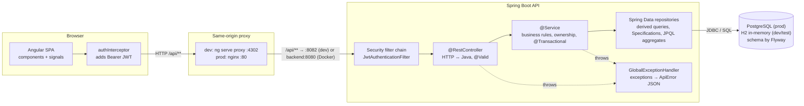
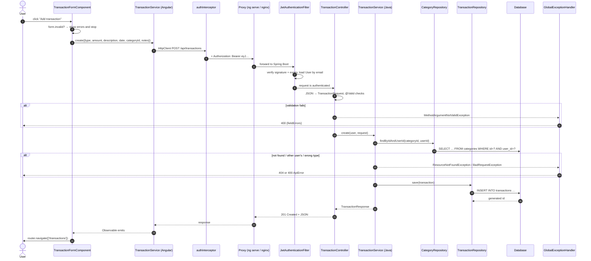
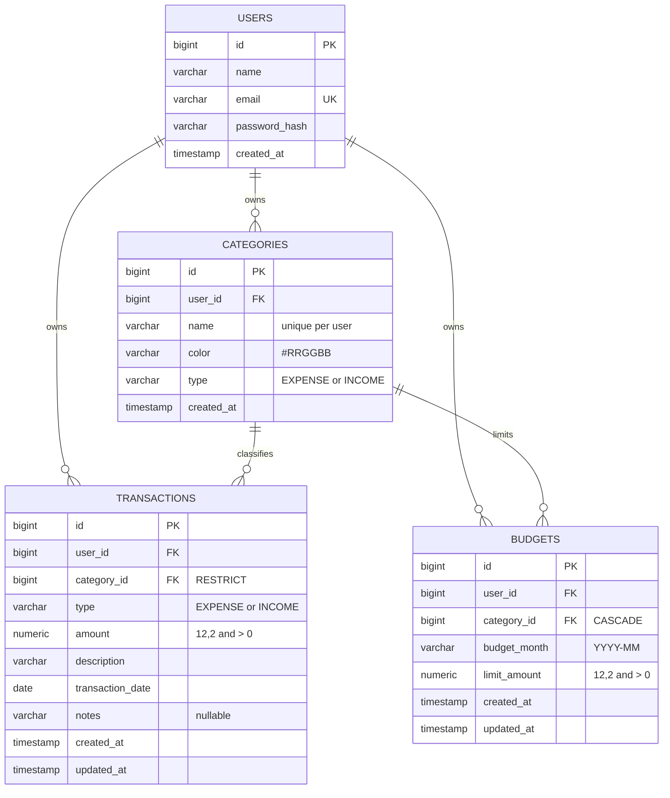
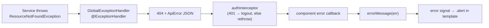

# How the Expense Tracker works

This guide explains the whole application, from the browser to the database, for a developer who is new to Spring Boot and Angular. Read it top to bottom once, then use it as a reference. Every source file is also commented, so you can jump from a section here straight into the code.

**Contents**

1. [Overview & features](#1-overview--features)
2. [Tech stack and why each piece was chosen](#2-tech-stack-and-why-each-piece-was-chosen)
3. [Architecture](#3-architecture)
4. [Project structure](#4-project-structure)
5. [Request lifecycle: one click, end to end](#5-request-lifecycle-one-click-end-to-end)
6. [Authentication & security in depth](#6-authentication--security-in-depth)
7. [Data model](#7-data-model)
8. [Business rules](#8-business-rules)
9. [API reference](#9-api-reference)
10. [Backend, layer by layer](#10-backend-layer-by-layer)
11. [Frontend explained](#11-frontend-explained)
12. [Error handling end to end](#12-error-handling-end-to-end)
13. [Testing](#13-testing)
14. [Configuration, profiles and environment variables](#14-configuration-profiles-and-environment-variables)
15. [Docker & deployment](#15-docker--deployment)
16. [Interview talking points](#16-interview-talking-points)
17. [Glossary](#17-glossary)

---

## 1. Overview & features

Expense Tracker answers three questions people ask about their money:

1. **Where did it go?** Every income and expense is recorded as a *transaction* and filed under a *category* (Food, Transport, Salary…).
2. **Am I on track?** Each expense category can have a monthly *budget*. Progress bars show how much of it is used.
3. **How is this month going compared to previous ones?** The *dashboard* summarises the month and the last six months.

### Features

| Area | What the user can do |
|---|---|
| Accounts | Register (gets 9 default categories), log in, log out. Sessions last 24 hours. |
| Transactions | Add / edit / delete. Filter by month, type (income or expense), category, and text in the description. Sort by date, amount or description. 20 per page. |
| Categories | Add / edit / delete with name, color and type. See how many transactions use each one. |
| Budgets | For a chosen month, set or edit a limit for any expense category, or remove it. See spent, remaining and % used. |
| Dashboard | Month picker; 4 summary cards (income, expenses, balance, savings rate); doughnut of spending by category; 6-month income vs expenses bars; daily spending line; budget progress; 5 most recent transactions. |
| Demo | `demo@example.com` / `password123`, seeded with about 3 months of data and budgets (one deliberately over budget). |

---

## 2. Tech stack and why each piece was chosen

### Backend

| Technology | Why it is used here |
|---|---|
| **Java 17** | Long-term-support version; gives us `record`s (compact immutable DTOs), text blocks (`"""` multi-line strings used for JPQL) and `var`. |
| **Spring Boot 3.5** | The most common Java framework for REST APIs in industry. "Starters" bring in a working web server, JSON handling, database access and security with almost no configuration. |
| **Spring Web (MVC)** | `@RestController` classes map URLs to Java methods; Jackson converts Java objects to and from JSON. |
| **Spring Data JPA + Hibernate** | Map Java classes (`@Entity`) to tables. Repositories are interfaces; Spring writes the implementation. Specifications build dynamic filters; `@Query` lets us write aggregate queries. |
| **Bean Validation** (Hibernate Validator) | Declarative rules on request DTOs (`@NotBlank`, `@DecimalMin`, `@PastOrPresent`), checked automatically with `@Valid`. |
| **Spring Security** | The standard way to secure Spring apps. We use its filter chain, `PasswordEncoder` (BCrypt) and `@AuthenticationPrincipal`. |
| **jjwt 0.12** | Small, well-maintained library to create and verify JSON Web Tokens. |
| **Flyway** | Versioned SQL migrations. The schema is created by plain SQL files that are reviewed like code and run exactly once per database. |
| **PostgreSQL** | Robust open-source relational database, available on every hosting platform. Exact `NUMERIC` type for money. |
| **H2 (PostgreSQL mode)** | In-memory database for development and tests: `./mvnw spring-boot:run` works with zero setup, and tests are fast and isolated. |
| **springdoc-openapi** | Generates OpenAPI docs and the Swagger UI from the controllers. |
| **JUnit 5, Mockito, AssertJ, MockMvc** | The standard Spring testing toolkit (all included in `spring-boot-starter-test`). |

### Frontend

| Technology | Why it is used here |
|---|---|
| **Angular 17** | A complete, opinionated framework (routing, HTTP, forms, testing included) widely used in enterprises. Version 17 is the newest that supports Node 18. |
| **Standalone components** | No `NgModule` boilerplate: each component lists what it uses in `imports`. This is the recommended style since Angular 15–17. |
| **Signals** | Angular's new reactivity primitive. Simple synchronous state (`signal`, `computed`) that updates the UI precisely, without manual subscriptions. |
| **Reactive forms** | Forms defined in TypeScript, with typed controls and validators, which makes them easy to test. |
| **RxJS** | HttpClient returns Observables; operators such as `debounceTime`, `forkJoin` and `merge` handle async flows. |
| **Chart.js 4** | Lightweight, popular canvas charting library with a simple API. |
| **SCSS** | CSS with nesting and variables, compiled by the Angular build. |
| **Jasmine + Karma** | Angular's default unit-test setup, run in headless Chrome. |

### Delivery

| Technology | Why |
|---|---|
| **Docker multi-stage builds** | Build with full toolchains, ship small runtime images. |
| **nginx** | Serves the static Angular files and reverse-proxies `/api` to the backend, so the browser sees one origin. |
| **Docker Compose** | One command starts Postgres, API and web app together. |
| **GitHub Actions** | Builds and tests both halves on every push, giving a visible green check. |

---

## 3. Architecture



**Key ideas:**

- **Single origin.** The browser only ever talks to one server: the Angular dev server in development, nginx in Docker. That server forwards `/api/**` to Spring Boot. Because of this, the browser never makes a cross-origin call and CORS is only a fallback.
- **Layered backend.** Each layer has one job. Controllers know HTTP but no business rules; services know business rules but not HTTP; repositories know SQL. Exceptions flow up to one central handler.
- **Stateless API.** The server keeps no session. Each request carries a JWT, so any instance of the backend can serve any request.
- **Feature-first packages.** Code is grouped by feature (`transaction`, `budget`, …) rather than by layer, so everything about budgets is in one folder.

---

## 4. Project structure

```
expense-tracker/
├── README.md                                   Pitch, features, quick start, demo login
├── docs/HOW-IT-WORKS.md                        This guide
├── docker-compose.yml                          Postgres + API + nginx/Angular in one command (port 8092)
├── .gitignore                                  Keeps build output, node_modules and IDE files out of Git
├── .github/workflows/ci.yml                    GitHub Actions: backend verify + frontend test & build
│
├── backend/
│   ├── pom.xml                                 Maven build: Spring Boot parent, dependencies, plugins
│   ├── mvnw, mvnw.cmd, .mvn/wrapper/           Maven wrapper: downloads and runs a pinned Maven version
│   ├── Dockerfile                              Multi-stage: Maven build → JRE-only runtime image
│   ├── .dockerignore                           Excludes target/ from the Docker build context
│   └── src/
│       ├── main/java/com/portfolio/expensetracker/
│       │   ├── ExpenseTrackerApplication.java  main(): starts Spring Boot, enables component scanning
│       │   ├── auth/
│       │   │   ├── AuthController.java         POST /register, POST /login, GET /me
│       │   │   ├── AuthService.java            Hash password, create user + default categories, issue JWT
│       │   │   └── dto/
│       │   │       ├── RegisterRequest.java    {name, email, password} with validation rules
│       │   │       ├── LoginRequest.java       {email, password}
│       │   │       ├── AuthResponse.java       {token, user}
│       │   │       └── UserResponse.java       Public user fields (never the hash)
│       │   ├── user/
│       │   │   ├── User.java                   @Entity for "users"; implements Spring Security's UserDetails
│       │   │   └── UserRepository.java         findByEmailIgnoreCase, existsByEmailIgnoreCase
│       │   ├── security/
│       │   │   ├── JwtService.java             Create and verify signed JWTs
│       │   │   └── JwtAuthenticationFilter.java Reads "Authorization: Bearer", sets the logged-in user
│       │   ├── config/
│       │   │   ├── SecurityConfig.java         Filter chain, public URLs, BCrypt, CORS, 401 entry point
│       │   │   ├── ClockConfig.java            Injectable Clock bean (testable "today")
│       │   │   ├── OpenApiConfig.java          Swagger UI title + "Authorize" button for JWT
│       │   │   └── DemoDataSeeder.java         Creates demo@example.com with 3 months of data
│       │   ├── common/
│       │   │   ├── ApiError.java               The JSON shape of every error response
│       │   │   ├── GlobalExceptionHandler.java Maps exceptions to 400/401/404/409 + ApiError
│       │   │   ├── ResourceNotFoundException.java  → 404 (missing OR someone else's)
│       │   │   ├── ConflictException.java      → 409 (duplicate name, category in use…)
│       │   │   ├── BadRequestException.java    → 400 for business rules (type mismatch, bad month)
│       │   │   ├── PageResponse.java           Stable pagination wrapper {content, page, size, totals}
│       │   │   ├── Months.java                 Parse/validate "YYYY-MM" strings
│       │   │   └── Money.java                  BigDecimal helpers: orZero, percent with rounding
│       │   ├── category/
│       │   │   ├── Category.java               @Entity: name, color, type, owner
│       │   │   ├── CategoryRepository.java     Ownership-scoped lookups, unique-name checks
│       │   │   ├── CategoryService.java        Unique names, delete-in-use 409, type-change guard, defaults
│       │   │   ├── CategoryController.java     CRUD /api/categories
│       │   │   ├── DefaultCategories.java      The 9 starter categories with colors
│       │   │   └── dto/
│       │   │       ├── CategoryRequest.java    {name, color (#hex), type}
│       │   │       ├── CategoryResponse.java   + transactionCount
│       │   │       └── CategoryUsage.java      Row of the "count per category" GROUP BY query
│       │   ├── transaction/
│       │   │   ├── Transaction.java            @Entity: type, amount (BigDecimal), description, date, notes
│       │   │   ├── TransactionType.java        enum INCOME / EXPENSE (shared with Category)
│       │   │   ├── TransactionRepository.java  Specifications + @EntityGraph + all aggregate JPQL queries
│       │   │   ├── TransactionSpecifications.java Composable filters: owner, month, type, category, text
│       │   │   ├── TransactionService.java     Ownership + category/type rule + CRUD + search
│       │   │   ├── TransactionController.java  CRUD + filtered, sorted, paginated list
│       │   │   └── dto/
│       │   │       ├── TransactionRequest.java Validation: amount > 0, 2 decimals, not in future…
│       │   │       └── TransactionResponse.java Includes a nested {id, name, color} category
│       │   ├── budget/
│       │   │   ├── Budget.java                 @Entity: category, month "YYYY-MM", limit
│       │   │   ├── BudgetRepository.java       Month lookup with category fetched, upsert lookup
│       │   │   ├── BudgetService.java          Upsert, expense-only rule, spent/remaining/percent
│       │   │   ├── BudgetController.java       GET ?month=, PUT (upsert), DELETE
│       │   │   └── dto/
│       │   │       ├── BudgetRequest.java      {categoryId, month, limit}
│       │   │       └── BudgetResponse.java     + spent, remaining, percentUsed
│       │   └── summary/
│       │       ├── SummaryController.java      GET /api/summary?month=
│       │       ├── SummaryService.java         Totals, savings rate, budget merge, gap filling
│       │       └── dto/
│       │           ├── SummaryResponse.java    The dashboard payload
│       │           ├── CategorySpending.java   Spent per category with optional budget
│       │           ├── DailySpending.java      One entry per day
│       │           ├── MonthlyTrend.java       Income/expense per month
│       │           ├── TypeTotal.java          Query row: SUM per type
│       │           ├── CategoryTotal.java      Query row: SUM per category
│       │           ├── DailyTotal.java         Query row: SUM per day
│       │           └── MonthTypeTotal.java     Query row: SUM per (year, month, type)
│       ├── main/resources/
│       │   ├── application.yml                 Dev defaults: port 8082, H2, Flyway, JWT, CORS
│       │   ├── application-prod.yml            Prod overrides from environment variables (Postgres)
│       │   └── db/migration/V1__create_tables.sql  users, categories, transactions, budgets (+ constraints)
│       └── test/java/com/portfolio/expensetracker/
│           ├── TestData.java                   Builds entities with ids for unit tests
│           ├── ApiIntegrationTest.java         10 full-stack tests through HTTP (MockMvc + H2)
│           ├── transaction/TransactionServiceTest.java  Type mismatch, ownership, trimming
│           ├── category/CategoryServiceTest.java        Delete-in-use, duplicates, type change
│           ├── budget/BudgetServiceTest.java            Upsert, income rejection, progress math
│           └── summary/SummaryServiceTest.java          Totals, savings rate, gap filling, budget merge
│
└── frontend/
    ├── package.json, package-lock.json         npm dependencies and scripts (start = ng serve --port 4302)
    ├── angular.json                            Angular CLI build/serve/test configuration (proxy, port, budgets)
    ├── proxy.conf.json                         Dev proxy: /api → http://localhost:8082 (changeOrigin false)
    ├── tsconfig*.json                          TypeScript compiler settings (strict mode)
    ├── Dockerfile                              Multi-stage: Node build → nginx image
    ├── nginx.conf                              Static files + /api reverse proxy + SPA fallback
    ├── .dockerignore, .editorconfig, .gitignore  Tooling files from the Angular scaffold
    ├── README.md                               Short pointer to the main docs
    └── src/
        ├── index.html                          The single HTML page; <app-root> is replaced by Angular
        ├── main.ts                             bootstrapApplication(AppComponent, appConfig)
        ├── styles.scss                         Global design system: colors, .card, .btn, .progress…
        ├── favicon.ico, assets/                Static assets
        └── app/
            ├── app.config.ts                   Providers: router, HttpClient + interceptor, locale
            ├── app.routes.ts                   Lazy routes with guards
            ├── app.component.{ts,html,scss}    Shell: navbar + <router-outlet>
            ├── core/
            │   ├── models.ts                   TypeScript interfaces mirroring the API DTOs
            │   ├── auth/auth.service.ts        Login/register/logout, token storage, user signal
            │   ├── auth/auth.interceptor.ts    Adds Bearer token; logs out on 401
            │   ├── auth/auth.guard.ts          authGuard / guestGuard for routes
            │   ├── auth/*.spec.ts              Tests for the service and interceptor
            │   ├── api/query-params.ts         Object → HttpParams, skipping empty filters
            │   ├── api/transaction.service.ts  /api/transactions calls (+ spec)
            │   ├── api/category.service.ts     /api/categories calls
            │   ├── api/budget.service.ts       /api/budgets calls
            │   └── api/summary.service.ts      /api/summary call
            ├── shared/
            │   ├── error-message.ts            HttpErrorResponse → user-friendly text (+ spec)
            │   ├── month.ts                    "YYYY-MM" helpers: current, shift, label (+ spec)
            │   ├── budget-level.ts             ok / warn (>80%) / over (>100%) (+ spec)
            │   ├── budget-bar.component.ts     Reusable progress bar
            │   └── month-picker.component.ts   ‹ Month › control with @Input/@Output
            └── features/
                ├── auth/                       login + register pages, shared auth-page.scss
                ├── dashboard/                  cards, 3 charts, budgets, recent list (+ component spec)
                ├── transactions/               list (filters, table, pagination, inline delete) + form
                ├── categories/                 list grouped by type + add/edit form
                └── budgets/                    per-month inline budget editor with progress
```

---

## 5. Request lifecycle: one click, end to end

Let's follow a real action: **the user fills in the "New transaction" form (Expense, $54.20, "Groceries", Food) and clicks "Add transaction".**



Step by step:

1. **Component** (`transaction-form.component.ts`, `submit()`): if the reactive form is invalid, it calls `markAllAsTouched()` so every error message appears, and stops. Otherwise it builds a `TransactionRequest` object from `form.getRawValue()`.
2. **Angular service** (`core/api/transaction.service.ts`, `create()`): calls `http.post('/api/transactions', body)`. Nothing is sent yet: the request goes out when the component subscribes.
3. **Interceptor** (`auth.interceptor.ts`): clones the request and adds `Authorization: Bearer <token>` from localStorage.
4. **Proxy**: in development `ng serve` forwards `/api/**` to `http://localhost:8082` (`proxy.conf.json`); in Docker nginx forwards it to `http://backend:8080`.
5. **Security filter chain** (`JwtAuthenticationFilter`): verifies the JWT's signature and expiry with `JwtService`, loads the `User` by the email in the token, and stores it in the `SecurityContext`. If the token is missing or invalid the request stays anonymous and Spring Security answers **401** before any controller runs.
6. **Controller** (`TransactionController.create`): Jackson parses JSON into the `TransactionRequest` record. `@Valid` runs the annotations (`@DecimalMin("0.01")`, `@PastOrPresent`…). On failure, **400** with `fieldErrors` is returned. `@AuthenticationPrincipal User user` injects the logged-in user.
7. **Service** (`TransactionService.create` → `apply`): loads the category **scoped to the user** (`findByIdAndUserId`), so another user's category gives **404**. Checks that the category type equals the transaction type (else **400**). Copies fields, trims the description, stores blank notes as `null`. The whole method runs in a database transaction (`@Transactional` on the class).
8. **Repository** (`TransactionRepository.save`): Hibernate issues `INSERT INTO transactions …`. The `@PrePersist` callback sets `createdAt`/`updatedAt`.
9. **Response**: the entity is converted to `TransactionResponse` (a DTO, never the entity itself), serialised to JSON, and returned with **201 Created** thanks to `@ResponseStatus(HttpStatus.CREATED)`.
10. **Back in Angular**: the Observable emits, and the component navigates to `/transactions`, which loads the list again.

---

## 6. Authentication & security in depth

### 6.1 Registration

`POST /api/auth/register` → `AuthService.register`:

1. Email is trimmed and lower-cased so `Jane@Example.com` and `jane@example.com` are the same account.
2. If it exists → `ConflictException` → **409**.
3. The password is hashed with **BCrypt** (`passwordEncoder.encode`) and the `User` is saved.
4. `CategoryService.createDefaults(user)` saves the 9 starter categories.
5. A JWT is generated and returned with the user, so registration also logs the user in.

All of this is one `@Transactional` method: if saving the categories failed, the user row would be rolled back too.

### 6.2 BCrypt

BCrypt is a password-hashing function designed to be **slow** (configurable "cost", 10 by default, meaning 2¹⁰ rounds) and **salted** (a random value mixed into each hash and stored inside it). The output looks like `$2a$10$N9qo8uLOickgx2ZMRZoMye…`:

- `$2a$` = algorithm version, `10` = cost, next 22 chars = salt, rest = hash.
- **Why slow?** If the database leaks, an attacker has to try passwords one by one; at ~100 ms per attempt, guessing is very expensive.
- **Why salted?** Two users with the same password get different hashes, so precomputed "rainbow tables" are useless.
- Login uses `passwordEncoder.matches(raw, hash)`, which re-hashes the attempt with the salt from the stored hash and compares.

### 6.3 Login

`POST /api/auth/login` → `AuthService.login` finds the user by email, checks the password, and returns a token. Wrong email **and** wrong password both produce the same `BadCredentialsException("Invalid email or password")` → **401**, so attackers can't use the endpoint to discover which emails are registered.

### 6.4 JWT structure

A token looks like `xxxxx.yyyyy.zzzzz`, three Base64URL parts:

```text
Header   {"alg":"HS384"}
Payload  {"sub":"demo@example.com","name":"Demo User","iat":1760457600,"exp":1760544000}
Signature HMAC-SHA384(base64url(header) + "." + base64url(payload), secretKey)
```

- `sub` (subject) = the user's email; `iat` = issued at; `exp` = expiry (24 h later, `app.jwt.expiration-ms`).
- JJWT picks the HMAC strength from the key length (≥ 256 bits → HS256, ≥ 384 → HS384, ≥ 512 → HS512). The dev key is 400 bits, so tokens are HS384.
- **Anyone can decode the payload** (paste a token into jwt.io), so it never contains secrets. What makes it trustworthy is the **signature**: changing even one character of the payload makes verification fail, and only the server knows the key.
- The key comes from `app.jwt.secret` (Base64). In production it **must** be overridden with the `JWT_SECRET` environment variable; anyone who knows the key can forge tokens.

### 6.5 The filter

`JwtAuthenticationFilter extends OncePerRequestFilter` and runs before Spring's own authentication filter (`addFilterBefore(...)` in `SecurityConfig`). For each request:

```java
String email = jwtService.extractEmail(token);         // throws if forged or expired
UserDetails user = userDetailsService.loadUserByUsername(email);
var authentication = new UsernamePasswordAuthenticationToken(user, null, user.getAuthorities());
SecurityContextHolder.getContext().setAuthentication(authentication);
```

Any exception is swallowed on purpose: the request continues **anonymously**, and the authorization rule `.anyRequest().authenticated()` then rejects it with 401 through `HttpStatusEntryPoint(HttpStatus.UNAUTHORIZED)`. One component reads tokens, another decides access.

Loading the user from the database on each request costs one indexed query, but it means a deleted account stops working immediately instead of when its token expires.

### 6.6 SecurityConfig in short

| Setting | Why |
|---|---|
| `csrf.disable()` | CSRF exploits cookies that browsers attach automatically. Our token is sent in a header that only our JavaScript adds, so CSRF doesn't apply. |
| `SessionCreationPolicy.STATELESS` | Never create an `HttpSession`; every request must carry its JWT. |
| `PUBLIC_ENDPOINTS` | Only register, login, Swagger, H2 console and `/error` are open. |
| `HttpStatusEntryPoint(401)` | APIs should answer 401, not redirect to a login page. |
| `BCryptPasswordEncoder` bean | Used by `AuthService` and the seeder. |
| CORS source | Allows the configured origins (`http://localhost:4200,http://localhost:4302` in dev). |

### 6.7 Frontend side

- **`AuthService`** stores the token and user in localStorage under `expensetracker.token` / `expensetracker.user`, and exposes `currentUser` and `isLoggedIn` **signals**.
- **`authInterceptor`** adds the header to every request and calls `logout()` on any 401 that isn't from `/api/auth/*` (an expired token sends the user back to the login page).
- **Guards**: `authGuard` redirects anonymous users to `/login`; `guestGuard` sends logged-in users away from login/register. Guards are **only UX**: anyone can edit JavaScript in their own browser, so the server never trusts the client.

### 6.8 Why stateless?

| Stateful sessions (cookie + server memory) | Stateless JWT (this app) |
|---|---|
| Server must store sessions; scaling to several instances needs sticky sessions or a shared store (Redis). | Any instance can verify any token with the shared key. |
| Easy to revoke (delete the session). | Hard to revoke before expiry; mitigated with short lifetimes (24 h here) and loading the user on each request. |
| Cookies are sent automatically → CSRF protection required. | Header added by JS → no CSRF; but the token in localStorage must be protected from XSS. |

For a portfolio API with a separate SPA, stateless JWT is the common, simple choice. §16 discusses the alternatives.

### 6.9 Why 404 (not 403) for other users' data

Every lookup is scoped by user id: `findByIdAndUserId(id, user.getId())`. If transaction 42 belongs to Alice and Bob requests it, the query simply finds nothing → `ResourceNotFoundException` → **404**. Answering 403 Forbidden would confirm that id 42 exists, leaking information (for example, how many records the system holds). With 404, "not yours" and "doesn't exist" are indistinguishable. The integration test `usersCannotSeeOrTouchEachOthersData` proves this for GET, DELETE, using another user's category, budgeting another user's category, lists and summaries.

This "scope every query" approach is also safer than checking ownership after loading: there is no code path that loads a foreign record and then forgets to check.

---

## 7. Data model



### Tables and columns

**users**

| Column | Type | Notes |
|---|---|---|
| id | BIGINT identity | Primary key generated by the database |
| name | VARCHAR(100) | Display name |
| email | VARCHAR(255) UNIQUE | Login name; stored lower-case |
| password_hash | VARCHAR(255) | BCrypt hash; the password itself is never stored |
| created_at | TIMESTAMP | |

**categories**

| Column | Type | Notes |
|---|---|---|
| id | BIGINT identity | |
| user_id | BIGINT → users, ON DELETE CASCADE | Owner |
| name | VARCHAR(50) | `UNIQUE (user_id, name)` |
| color | VARCHAR(7) | `#RRGGBB`, stored lower-case |
| type | VARCHAR(10) | `EXPENSE` or `INCOME` (enum stored as text) |
| created_at | TIMESTAMP | |

**transactions**

| Column | Type | Notes |
|---|---|---|
| id | BIGINT identity | |
| user_id | BIGINT → users, ON DELETE CASCADE | Owner |
| category_id | BIGINT → categories (RESTRICT) | The DB refuses to delete a category that is in use |
| type | VARCHAR(10) | Must equal the category's type (enforced in the service) |
| amount | NUMERIC(12,2) CHECK (> 0) | Always positive; `type` decides the sign |
| description | VARCHAR(255) | |
| transaction_date | DATE | `DATE` is a keyword, hence the name |
| notes | VARCHAR(1000) NULL | |
| created_at / updated_at | TIMESTAMP | Set by `@PrePersist` / `@PreUpdate` |

Indexes: `(user_id, transaction_date)` for month filters and every summary query; `(category_id)` for "is this category in use" and per-category sums.

**budgets**

| Column | Type | Notes |
|---|---|---|
| id | BIGINT identity | |
| user_id | BIGINT → users, ON DELETE CASCADE | |
| category_id | BIGINT → categories, ON DELETE CASCADE | A budget is meaningless without its category |
| budget_month | VARCHAR(7) | `YYYY-MM`; sorts correctly as text |
| limit_amount | NUMERIC(12,2) CHECK (> 0) | `LIMIT` is an SQL keyword |
| created_at / updated_at | TIMESTAMP | |

`UNIQUE (user_id, category_id, budget_month)`: one budget per category per month, which is what makes `PUT /api/budgets` an upsert.

### Why these choices?

- **Money as `NUMERIC(12,2)` / `BigDecimal`**: binary floating point (`double`) can't represent 0.10 exactly; `0.1 + 0.2 = 0.30000000000000004`. Exact decimals avoid cents drifting over many additions.
- **Positive amounts + a type column** instead of signed amounts: sums are simple (`SUM(amount) WHERE type = 'EXPENSE'`) and there is no "negative expense" ambiguity.
- **"Spent" is never stored** on the budget. It is always computed from transactions, so it can't go stale when a transaction is edited (single source of truth).
- **Rules are in two places on purpose**: the service gives friendly messages; the database constraints (UNIQUE, CHECK, FK) are the last line of defence if a bug or a race bypasses the service.

### Flyway

At startup Flyway looks in `src/main/resources/db/migration` and runs every `V<n>__<description>.sql` that hasn't run yet, in order, recording each in `flyway_schema_history`. Hibernate is set to `ddl-auto: validate`, so it **checks** that the entities match the tables and refuses to start if they don't; it never alters the schema itself.

To change the schema later, never edit `V1`; add `V2__add_recurring_flag.sql` with an `ALTER TABLE`. The same files run on H2 (dev/tests) and Postgres (prod) because H2 runs in `MODE=PostgreSQL` and the SQL sticks to portable features (`GENERATED BY DEFAULT AS IDENTITY`, `NUMERIC`, `CHECK`, named constraints).

---

## 8. Business rules

Each rule, where it is enforced, and which test proves it. "Unit" tests are in `backend/src/test/java/.../<feature>/…ServiceTest.java`; "IT" tests are in `ApiIntegrationTest.java`.

| # | Rule | Enforced in | Covered by |
|---|---|---|---|
| R1 | Every API call except register/login requires a valid JWT | `SecurityConfig` (`anyRequest().authenticated()`) + `JwtAuthenticationFilter` | IT `protectedEndpoints_requireAValidToken`; frontend `authInterceptor` spec |
| R2 | Email is unique (case-insensitive) → 409 | `AuthService.register` + `UNIQUE(email)` | IT `login_withWrongPassword_returns401_andDuplicateEmail_returns409` |
| R3 | Wrong credentials → 401 with a generic message | `AuthService.login` | IT `login_withWrongPassword_…` |
| R4 | New users receive 9 default categories (Salary = INCOME) | `AuthService.register` → `CategoryService.createDefaults` | IT `register_createsTheDefaultCategories` |
| R5 | Users only see and modify their own data; others' ids → 404 | `findByIdAndUserId` in every service; `ownedBy` Specification; `user.id = :userId` in every aggregate query | IT `usersCannotSeeOrTouchEachOthersData`; unit `create_throwsNotFound_whenCategoryBelongsToAnotherUser`, `update_throwsNotFound_forAnotherUsersTransaction` |
| R6 | Amount > 0, at most 10 integer digits and 2 decimals | `TransactionRequest` (`@DecimalMin("0.01")`, `@Digits`) + DB `CHECK (amount > 0)` | IT `invalidTransaction_returnsFieldErrors` |
| R7 | Transaction date not in the future; description required | `TransactionRequest` (`@PastOrPresent`, `@NotBlank`) | IT `invalidTransaction_returnsFieldErrors` |
| R8 | Category type must equal transaction type → 400 with `fieldErrors.categoryId` | `TransactionService.apply` | unit `create_rejectsCategoryWhoseTypeDoesNotMatch`; IT `transactionTypeMustMatchCategoryType` |
| R9 | Category names unique per user (case-insensitive) → 409 | `CategoryService.create/update` + `UNIQUE(user_id, name)` | unit `create_duplicateName_throwsConflict`; IT `categoryNamesAreUniquePerUser_andColorIsValidated` |
| R10 | Category color must be `#RRGGBB` | `CategoryRequest` (`@Pattern`) | IT `categoryNamesAreUniquePerUser_andColorIsValidated` |
| R11 | A category with transactions cannot be deleted → 409 with the count | `CategoryService.delete` + FK without cascade | unit `delete_categoryWithTransactions_throwsConflict_andDeletesNothing`; IT `deletingACategoryInUse_returns409_butUnusedOneCanBeDeleted` |
| R12 | A category's type can't change while transactions/budgets use it → 409 | `CategoryService.update` | unit `update_changingTypeOfCategoryInUse_throwsConflict` |
| R13 | Budgets only on EXPENSE categories → 400 | `BudgetService.upsert` | unit `upsert_rejectsIncomeCategories`; IT `budgetsAndSummary_computeTheRightNumbers` |
| R14 | One budget per (user, category, month); PUT updates the existing one | `BudgetService.upsert` + `UNIQUE(user_id, category_id, budget_month)` | unit `upsert_updatesTheExistingBudget_insteadOfCreatingADuplicate`; IT `budgetsAndSummary_…` (same id returned twice) |
| R15 | Budget limit > 0, month in `YYYY-MM` | `BudgetRequest` (`@DecimalMin`, `@Pattern(Months.PATTERN)`) + DB `CHECK` | covered by validation handling (same mechanism as R6) |
| R16 | Budget progress: spent, remaining (negative when over), percentUsed (1 decimal) | `BudgetService.toResponse`, `Money.percent` | unit `list_defaultsToCurrentMonth_andComputesOverBudgetProgress`; IT `budgetsAndSummary_…` (112.5 %, −10) |
| R17 | Summary totals, balance and savings rate (0 when there's no income) | `SummaryService.summary` | unit `computesTotalsBalanceAndSavingsRate`, `withNoIncome_savingsRateIsZero_notADivisionByZero`; IT `budgetsAndSummary_…` |
| R18 | Daily series has every day of the month; trend has 6 months; gaps are zero | `SummaryService.dailySpending/trend` | unit `dailySpending_hasEveryDayOfTheMonth_withZerosForEmptyDays` (leap Feb 2028), `trend_coversSixMonthsOldestFirst_…` |
| R19 | Spending by category merges budgets; categories with a budget but no spending still appear; no budget → `null` | `SummaryService.spendingByCategory` | unit `spendingByCategory_mergesBudgets_includingBudgetsWithoutSpending` |
| R20 | Missing `month` = current month (from the injected Clock); malformed → 400 | `Months.parseOrCurrent` / `Months.parse` | unit `trend_…_andDefaultsToClockMonth`, `rejectsMalformedMonth`; IT `budgetsAndSummary_…` (`month=September`) |
| R21 | Unknown sort property → 400 (not 500) | `GlobalExceptionHandler` (`PropertyReferenceException`) | IT `transactions_fullCrud_withFiltersSortingAndPagination` |
| R22 | Budget bars: amber above 80 %, red above 100 % | Frontend `shared/budget-level.ts` | `budget-level.spec.ts`, `dashboard.component.spec.ts` |

---

## 9. API reference

Base URL: `http://localhost:8082` when calling the backend directly, or just `/api/...` through the dev proxy / nginx. All bodies are JSON. All endpoints except the first two require `Authorization: Bearer <token>`.

| Method | Path | Body | Success | Errors |
|---|---|---|---|---|
| POST | `/api/auth/register` | `{name, email, password}` | 201 `AuthResponse` | 400, 409 |
| POST | `/api/auth/login` | `{email, password}` | 200 `AuthResponse` | 400, 401 |
| GET | `/api/auth/me` | – | 200 `{id, name, email}` | 401 |
| GET | `/api/categories` | – | 200 `Category[]` | 401 |
| GET | `/api/categories/{id}` | – | 200 `Category` | 404 |
| POST | `/api/categories` | `{name, color, type}` | 201 `Category` | 400, 409 |
| PUT | `/api/categories/{id}` | `{name, color, type}` | 200 `Category` | 400, 404, 409 |
| DELETE | `/api/categories/{id}` | – | 204 | 404, 409 (in use) |
| GET | `/api/transactions` | query: `month, type, categoryId, q, page, size, sort` | 200 `Page<Transaction>` | 400 |
| GET | `/api/transactions/{id}` | – | 200 `Transaction` | 404 |
| POST | `/api/transactions` | `{type, amount, description, date, categoryId, notes?}` | 201 `Transaction` | 400, 404 (category) |
| PUT | `/api/transactions/{id}` | same as POST | 200 `Transaction` | 400, 404 |
| DELETE | `/api/transactions/{id}` | – | 204 | 404 |
| GET | `/api/budgets?month=YYYY-MM` | – (month defaults to current) | 200 `Budget[]` | 400 |
| PUT | `/api/budgets` | `{categoryId, month, limit}` | 200 `Budget` (created or updated) | 400, 404 |
| DELETE | `/api/budgets/{id}` | – | 204 | 404 |
| GET | `/api/summary?month=YYYY-MM` | – (month defaults to current) | 200 `Summary` | 400 |

Interactive docs: **http://localhost:8082/swagger-ui.html** (click *Authorize* and paste a token).

### List parameters for `GET /api/transactions`

| Param | Example | Meaning |
|---|---|---|
| `month` | `2026-10` | Only that calendar month (omit for all time) |
| `type` | `EXPENSE` | `INCOME` or `EXPENSE` |
| `categoryId` | `3` | One category |
| `q` | `coffee` | Case-insensitive "description contains" |
| `page` | `0` | Zero-based page index (default 0) |
| `size` | `20` | Page size (default 20, max 100) |
| `sort` | `amount,desc` | Any entity property + direction; default `date,desc` then `id,desc` |

### Examples

**Login**

```http
POST /api/auth/login
Content-Type: application/json

{ "email": "demo@example.com", "password": "password123" }
```

```json
{
  "token": "eyJhbGciOiJIUzM4NCJ9.eyJzdWIiOiJkZW1vQGV4YW1wbGUuY29tIiwi...",
  "user": { "id": 1, "name": "Demo User", "email": "demo@example.com" }
}
```

**Create a transaction**

```http
POST /api/transactions
Authorization: Bearer eyJ...
Content-Type: application/json

{ "type": "EXPENSE", "amount": 54.20, "description": "Groceries",
  "date": "2026-10-03", "categoryId": 1, "notes": null }
```

```json
{
  "id": 68,
  "type": "EXPENSE",
  "amount": 54.20,
  "description": "Groceries",
  "date": "2026-10-03",
  "notes": null,
  "category": { "id": 1, "name": "Food", "color": "#f97316" },
  "createdAt": "2026-10-14T16:10:39.123Z",
  "updatedAt": "2026-10-14T16:10:39.123Z"
}
```

**List transactions**: `GET /api/transactions?month=2026-10&size=2&sort=amount,desc` (ids and timestamps illustrative)

```json
{
  "content": [
    { "id": 45, "type": "INCOME", "amount": 3200.00, "description": "Monthly salary", "date": "2026-10-01",
      "notes": null, "category": { "id": 8, "name": "Salary", "color": "#22c55e" }, "createdAt": "…", "updatedAt": "…" },
    { "id": 46, "type": "EXPENSE", "amount": 1150.00, "description": "Rent", "date": "2026-10-01",
      "notes": null, "category": { "id": 3, "name": "Housing", "color": "#8b5cf6" }, "createdAt": "…", "updatedAt": "…" }
  ],
  "page": 0,
  "size": 2,
  "totalElements": 15,
  "totalPages": 8
}
```

**Upsert a budget**

```http
PUT /api/budgets
{ "categoryId": 5, "month": "2026-10", "limit": 80 }
```

```json
{ "id": 7, "categoryId": 5, "categoryName": "Entertainment", "color": "#ec4899", "month": "2026-10",
  "limit": 80.00, "spent": 117.00, "remaining": -37.00, "percentUsed": 146.3 }
```

**Summary**: `GET /api/summary?month=2026-10` (abridged; real numbers from the demo account)

```json
{
  "month": "2026-10",
  "totalIncome": 3200.00,
  "totalExpense": 1826.04,
  "balance": 1373.96,
  "savingsRate": 42.9,
  "spendingByCategory": [
    { "categoryId": 3, "name": "Housing", "color": "#8b5cf6", "spent": 1150.00, "budget": null, "percentUsed": null },
    { "categoryId": 1, "name": "Food", "color": "#f97316", "spent": 192.04, "budget": 450.00, "percentUsed": 42.7 },
    { "categoryId": 5, "name": "Entertainment", "color": "#ec4899", "spent": 117.00, "budget": 80.00, "percentUsed": 146.3 }
  ],
  "dailySpending": [
    { "date": "2026-10-01", "amount": 1225.00 },
    "… one entry for each of the 31 days, 0 for days without spending …"
  ],
  "trend": [
    { "month": "2026-05", "income": 0, "expense": 0 },
    { "month": "2026-06", "income": 0, "expense": 0 },
    { "month": "2026-07", "income": 0, "expense": 0 },
    { "month": "2026-08", "income": 3624.43, "expense": 2150.46 },
    { "month": "2026-09", "income": 3673.92, "expense": 2171.68 },
    { "month": "2026-10", "income": 3200.00, "expense": 1826.04 }
  ]
}
```

**Error examples**

```json
// 400: validation
{ "timestamp": "2026-10-14T16:00:00Z", "status": 400, "error": "Bad Request", "message": "Validation failed",
  "fieldErrors": { "amount": "must be greater than 0", "date": "cannot be in the future" } }

// 400: category type mismatch
{ "status": 400, "error": "Bad Request",
  "message": "Category 'Salary' is an income category and cannot be used for expense transactions",
  "fieldErrors": { "categoryId": "Category 'Salary' is an income category and cannot be used for expense transactions" } }

// 409: category in use
{ "status": 409, "error": "Conflict",
  "message": "Category 'Food' is used by 24 transactions. Move or delete those transactions first.", "fieldErrors": {} }
```

---

## 10. Backend, layer by layer

### 10.1 Entities (`@Entity`)

An entity is a Java class mapped to a table. Hibernate reads and writes rows as objects.

```java
@Entity
@Table(name = "transactions")
public class Transaction {
    @Id @GeneratedValue(strategy = GenerationType.IDENTITY)   // DB generates the id
    private Long id;

    @ManyToOne(fetch = FetchType.LAZY, optional = false)      // many transactions → one category
    @JoinColumn(name = "category_id", nullable = false)
    private Category category;

    @Enumerated(EnumType.STRING)                              // stored as 'EXPENSE', not 0
    private TransactionType type;

    @Column(nullable = false, precision = 12, scale = 2)      // NUMERIC(12,2)
    private BigDecimal amount;

    @PrePersist void onCreate() { createdAt = updatedAt = Instant.now(); }
}
```

- `FetchType.LAZY` means the category is loaded only when it's used. On the list endpoint we avoid "N+1 queries" with `@EntityGraph(attributePaths = "category")`, which fetches categories in the same SQL with a JOIN.
- Entities have a `protected` no-arg constructor for JPA, and setters only for fields that may change (no `setId`, no `setUser`).

### 10.2 DTOs (records)

Requests and responses are Java `record`s, separate from entities:

```java
public record TransactionRequest(
        @NotNull TransactionType type,
        @NotNull @DecimalMin(value = "0.01", message = "must be greater than 0")
        @Digits(integer = 10, fraction = 2) BigDecimal amount,
        @NotBlank @Size(max = 255) String description,
        @NotNull @PastOrPresent(message = "cannot be in the future") LocalDate date,
        @NotNull Long categoryId,
        @Size(max = 1000) String notes) { }
```

Why separate DTOs? Clients can only send what we allow (no `id`, no `user`), we never leak internal fields (password hashes), and the API contract can evolve independently of the database.

### 10.3 Repositories

```java
public interface TransactionRepository
        extends JpaRepository<Transaction, Long>, JpaSpecificationExecutor<Transaction> {

    Optional<Transaction> findByIdAndUserId(Long id, Long userId);   // derived query

    @Query("""
            select new com.portfolio.expensetracker.summary.dto.CategoryTotal(c.id, c.name, c.color, sum(t.amount))
            from Transaction t join t.category c
            where t.user.id = :userId and t.type = :type and t.date between :from and :to
            group by c.id, c.name, c.color
            order by sum(t.amount) desc
            """)
    List<CategoryTotal> totalsByCategory(Long userId, TransactionType type, LocalDate from, LocalDate to);
}
```

- **Derived queries**: Spring parses `findByIdAndUserId` and writes `WHERE id = ? AND user_id = ?`.
- **JPQL `@Query`**: queries over entities (`Transaction t`, `t.category`), not tables. `select new …CategoryTotal(...)` is a constructor expression that returns typed records.
- **Why aggregate in SQL?** The database returns ~10 rows (one per category) instead of hundreds of transactions; it's faster, uses less memory, and stays fast as history grows. The `(user_id, transaction_date)` index makes the date-range filter cheap.

The four summary queries: `sumByType` (income/expense totals), `totalsByCategory`, `dailyTotals`, `monthlyTotals` (uses JPQL `year()`/`month()` functions, which Hibernate translates for H2 and Postgres).

### 10.4 Specifications (dynamic filters)

```java
var spec = ownedBy(user.getId())
        .and(inMonth(ym))
        .and(hasType(type))
        .and(inCategory(categoryId))
        .and(descriptionContains(query));
transactions.findAll(spec, pageable);
```

Each helper returns `null` when its filter is absent, and `and(null)` is ignored, so 4 optional filters don't need 16 repository methods. `descriptionContains` escapes `%` and `_` so user input can't act as SQL wildcards. (Values are always bound as parameters, so there's no SQL injection either way.)

### 10.5 Services (`@Service`, `@Transactional`)

Services hold the business rules. `@Transactional` on the class wraps each public method in a database transaction: commit on success, rollback on a `RuntimeException`. Read methods use `@Transactional(readOnly = true)`, a hint that lets Hibernate skip change tracking.

Upsert in `BudgetService`:

```java
Budget budget = budgets.findByUserIdAndCategoryIdAndMonth(user.getId(), category.getId(), ym.toString())
        .orElseGet(() -> new Budget(user, category, ym.toString()));   // update if found, else create
budget.setLimitAmount(request.limit());
Budget saved = budgets.saveAndFlush(budget);
```

Gap filling in `SummaryService`:

```java
Map<LocalDate, BigDecimal> byDay = /* rows from dailyTotals(...) */;
return from.datesUntil(to.plusDays(1))                               // every day of the month
        .map(day -> new DailySpending(day, byDay.getOrDefault(day, BigDecimal.ZERO)))
        .toList();
```

Percentages with exact rounding (`Money.percent`):

```java
part.multiply(BigDecimal.valueOf(100)).divide(whole, 1, RoundingMode.HALF_UP).doubleValue();
```

`BigDecimal.divide` needs a scale and rounding mode, because results like 1/3 never end.

### 10.6 Controllers (`@RestController`)

```java
@GetMapping
public PageResponse<TransactionResponse> list(
        @AuthenticationPrincipal User user,
        @RequestParam(required = false) String month,
        @RequestParam(required = false) TransactionType type,
        @RequestParam(required = false) Long categoryId,
        @RequestParam(name = "q", required = false) String query,
        @PageableDefault(size = 20)
        @SortDefault.SortDefaults({
                @SortDefault(sort = "date", direction = Sort.Direction.DESC),
                @SortDefault(sort = "id", direction = Sort.Direction.DESC)}) Pageable pageable) {
    return service.search(user, month, type, categoryId, query, pageable);
}
```

Controllers are deliberately thin: bind HTTP inputs, validate with `@Valid`, call one service method, return a DTO. `@ResponseStatus(HttpStatus.CREATED)` / `NO_CONTENT` set the success code.

### 10.7 Cross-cutting pieces

- **`GlobalExceptionHandler`** (`@RestControllerAdvice`): maps exceptions to HTTP codes (§12).
- **`ClockConfig`**: a `Clock` bean. Services call `LocalDate.now(clock)` / `YearMonth.now(clock)` so tests can freeze time.
- **`DemoDataSeeder`** (`CommandLineRunner`, `@ConditionalOnProperty`): runs after startup, only when `app.seed-demo-data=true`; idempotent (skips if the demo user exists). Uses a fixed-seed `Random` for reproducible amounts and never creates future-dated transactions.

---

## 11. Frontend explained

### 11.1 Bootstrapping and configuration

`main.ts` calls `bootstrapApplication(AppComponent, appConfig)`. `app.config.ts` registers providers:

```ts
providers: [
  provideRouter(routes, withComponentInputBinding()),       // route params → @Input()
  provideHttpClient(withInterceptors([authInterceptor])),    // JWT on every request
  { provide: LOCALE_ID, useValue: 'en-US' },                 // CurrencyPipe/DatePipe formats
]
```

### 11.2 Routing

`app.routes.ts` maps URLs to **lazy-loaded** components:

```ts
{ path: 'transactions/:id/edit', canActivate: [authGuard],
  loadComponent: () => import('./features/transactions/transaction-form.component')
                         .then((m) => m.TransactionFormComponent) },
```

Each page becomes its own JavaScript chunk (see the `ng build` output: the dashboard chunk with Chart.js is about 200 kB, but only downloaded when the dashboard is opened). `withComponentInputBinding()` makes the `:id` parameter arrive as the form's `@Input() id`.

### 11.3 Standalone components

Every component has `standalone: true` and lists what its template uses:

```ts
@Component({
  selector: 'app-dashboard',
  standalone: true,
  imports: [RouterLink, CurrencyPipe, DatePipe, DecimalPipe, MonthPickerComponent, BudgetBarComponent],
  templateUrl: './dashboard.component.html',
  styleUrl: './dashboard.component.scss',
})
```

Component styles are **scoped**: `.row` in `budget-list.component.scss` cannot affect other pages. Shared styles live in `styles.scss`.

### 11.4 Signals

```ts
readonly month = signal(currentMonth());                    // writable state
readonly summary = signal<Summary | null>(null);
readonly budgeted = computed(() =>                          // derived state, recalculated automatically
  (this.summary()?.spendingByCategory ?? []).filter((c) => c.budget !== null));
```

- Read a signal by calling it: `month()`. Write with `set()` / `update()`.
- Templates that read signals re-render exactly when they change.
- `toSignal(observable)` converts an RxJS stream to a signal (used in the transaction form for the selected type, which drives `categoryOptions = computed(...)`).

### 11.5 Control flow (`@if`, `@for`)

Angular 17's built-in syntax replaces `*ngIf`/`*ngFor`:

```html
@if (summary(); as s) {
  …
} @else if (loading()) {
  <p class="muted">Loading…</p>
}

@for (t of recent(); track t.id) { <li>…</li> } @empty { <li>No transactions</li> }
```

`track` tells Angular how to identify items so it can reuse DOM nodes. Gotcha: in Angular 17, `as` is only allowed on the first `@if`, not on `@else if`, so the pagination block nests two `@if`s.

### 11.6 Reactive forms

```ts
readonly form = this.fb.group({
  type: this.fb.nonNullable.control<TransactionType>('EXPENSE'),
  amount: this.fb.control<number | null>(null,
    [Validators.required, Validators.min(0.01), Validators.pattern(/^\d{1,10}(\.\d{1,2})?$/)]),
  description: this.fb.nonNullable.control('', [Validators.required, Validators.maxLength(255)]),
  date: this.fb.nonNullable.control(todayIso(), Validators.required),
  categoryId: this.fb.control<number | null>(null, Validators.required),
  notes: this.fb.nonNullable.control('', Validators.maxLength(1000)),
});
```

- The template binds with `[formGroup]="form"` and `formControlName="amount"`.
- Errors appear only after a control is *touched*; on submit, `markAllAsTouched()` reveals them all.
- Validators mirror the backend DTO for instant feedback; the backend is still the authority.
- **Selects**: we bind `<select>` with `formControlName`/`[formControl]` and `<option [ngValue]="…">`. A plain `<select [value]="x">` whose options are created by `@for` would show the first option, because the value is applied before the options exist; the forms API re-applies it as options appear. `[ngValue]` also keeps numbers as numbers (`[value]` turns them into strings).
- Filters on the transactions page are standalone `FormControl`s; their `valueChanges` streams are merged, the search box is debounced 300 ms, and `takeUntilDestroyed()` unsubscribes automatically.

### 11.7 Services and HTTP

API services (`core/api/*.service.ts`) are `@Injectable({ providedIn: 'root' })` singletons that wrap `HttpClient`. Components never build URLs. `toParams()` drops empty filters so the backend treats them as "no filter". `forkJoin` runs several requests in parallel and emits once when all have completed (dashboard: summary + recent transactions; budgets page: categories + budgets + summary).

### 11.8 The interceptor and the proxy

`authInterceptor` adds the header and handles 401s (§6.7). In development, `proxy.conf.json` forwards `/api` to `http://localhost:8082`:

```json
{ "/api": { "target": "http://localhost:8082", "secure": false, "changeOrigin": false } }
```

`changeOrigin: false` keeps the original `Host` header (`localhost:4302`) matching the browser's `Origin` header (`http://localhost:4302`). With `true` the proxy rewrites `Host` to `localhost:8082`; Spring then sees an Origin that differs from the Host, treats the call as cross-origin, and (if that origin isn't allowed) answers **403 "Invalid CORS request"**. That only happens in a real browser, because curl doesn't send `Origin` unless asked. The dev CORS list (`http://localhost:4200,http://localhost:4302`) is a second safety net.

### 11.9 Charts

The dashboard uses Chart.js:

```ts
Chart.register(...registerables);   // Chart.js is tree-shakable; register chart types once

new Chart(canvas, {
  type: 'doughnut',
  data: { labels: rows.map((c) => c.name),
          datasets: [{ data: rows.map((c) => c.spent), backgroundColor: rows.map((c) => c.color) }] },
  options: { responsive: true, maintainAspectRatio: false, cutout: '62%' },
});
```

- Canvases live inside `@if` blocks, so they're captured with `@ViewChild` **setters** that run whenever Angular creates or removes them.
- Charts are drawn only when both the data and the view are ready; `setTimeout` waits one tick so the `@if` content exists.
- Old charts are `destroy()`ed before redrawing and in `ngOnDestroy`, otherwise Chart.js leaks memory and event listeners. They're stored as `Pick<Chart, 'destroy'>[]` because each chart type has a different generic type.
- Category colors come from the API, so the doughnut, swatches and budget bars all match.

### 11.10 Money formatting

`{{ t.amount | currency: 'USD' }}` → `$54.20`. The frontend never adds amounts together; all totals come from the backend, computed exactly with `BigDecimal`. (The budgets page sums budget limits for its header bar; that's display-only.)

### 11.11 Inline confirmations

Deletes use a signal holding the id being confirmed (`confirmingDeleteId`), and the row swaps its buttons for "Delete? Yes / No". This avoids `window.confirm()`, which blocks the page, can't be styled, and is awkward to test.

---

## 12. Error handling end to end



### Backend

| Exception | Thrown by | HTTP |
|---|---|---|
| `MethodArgumentNotValidException` | Spring, when `@Valid` fails | 400 + `fieldErrors` |
| `BadRequestException` | services (type mismatch, income budget, bad month) | 400 (+ `fieldErrors` when a field is known) |
| `HttpMessageNotReadableException`, `MethodArgumentTypeMismatchException`, `PropertyReferenceException` | Spring (bad JSON, bad enum, `/abc` as id, unknown sort) | 400 "Malformed request" |
| `BadCredentialsException` | `AuthService.login` | 401 |
| (no/invalid token) | Spring Security entry point | 401 (empty body) |
| `ResourceNotFoundException` | services | 404 |
| `ConflictException` | services | 409 |
| `DataIntegrityViolationException` | database constraint (race conditions) | 409 |
| anything else | – | 500 (Spring Boot default; no stack trace leaked) |

Services never mention HTTP; they throw meaningful exceptions. The handler is the single place that decides status codes and the JSON shape:

```json
{ "timestamp": "…", "status": 409, "error": "Conflict", "message": "…", "fieldErrors": {} }
```

### Frontend

1. `authInterceptor` catches every error; on 401 (outside `/api/auth/*`) it logs the user out; it always re-throws.
2. The component's `error:` callback calls `errorMessage(err, fallback)` (`shared/error-message.ts`):
   - status 0 → "Cannot reach the server. Is the backend running?"
   - `fieldErrors` → "amount must be greater than 0; date cannot be in the future"
   - `message` → shown as-is (e.g. the 409 "used by 24 transactions" text)
   - otherwise → the fallback.
3. The text goes into an `error` signal and is rendered in an `.alert` box with `role="alert"` (screen readers announce it).

---

## 13. Testing

### 13.1 How to run

```bash
# Backend: compiles, runs all unit + integration tests, packages the jar
cd backend
./mvnw -B verify

# Frontend: Jasmine specs in headless Chrome
cd frontend
npx ng test --watch=false --browsers=ChromeHeadless
# on macOS, if Chrome isn't found:
CHROME_BIN="/Applications/Google Chrome.app/Contents/MacOS/Google Chrome" npx ng test --watch=false --browsers=ChromeHeadless
```

Current counts: **26 backend tests** (16 unit + 10 integration) and **14 frontend specs**, all passing.

### 13.2 The testing pyramid used here

- **Unit tests** (many, fast): one class at a time, dependencies replaced by Mockito mocks, no Spring context, no database. They run in milliseconds and pinpoint the broken rule.
- **Integration tests** (fewer, slower): the whole Spring application on an in-memory H2 database, called through HTTP with MockMvc. They prove the layers are wired correctly (JSON, validation, security, real SQL, error mapping).
- **Frontend unit/component tests**: services with `HttpTestingController` (no real network), pure functions, and one component test that renders the dashboard template.

### 13.3 Backend unit tests (Mockito)

| Test class | Test | What it proves |
|---|---|---|
| `TransactionServiceTest` | `create_rejectsCategoryWhoseTypeDoesNotMatch` | An expense filed under "Salary" → `BadRequestException` on field `categoryId`; nothing saved |
| | `create_throwsNotFound_whenCategoryBelongsToAnotherUser` | Scoped category lookup → 404 for foreign categories |
| | `create_trimsDescription_andStoresBlankNotesAsNull` | Input normalisation; the saved entity belongs to the caller |
| | `update_throwsNotFound_forAnotherUsersTransaction` | Ownership on update; no save happens |
| `CategoryServiceTest` | `delete_categoryWithTransactions_throwsConflict_andDeletesNothing` | Delete-in-use → 409 with the count; neither category nor budgets deleted |
| | `create_duplicateName_throwsConflict` | Unique names per user |
| | `update_changingTypeOfCategoryInUse_throwsConflict` | Type can't flip while in use |
| `BudgetServiceTest` | `upsert_updatesTheExistingBudget_insteadOfCreatingADuplicate` | Upsert updates the same object |
| | `upsert_rejectsIncomeCategories` | Budgets only for expenses |
| | `list_defaultsToCurrentMonth_andComputesOverBudgetProgress` | Fixed Clock → current month; 100/80 → 125 %, remaining −20 |
| `SummaryServiceTest` | `computesTotalsBalanceAndSavingsRate` | 3000 − 2250.50 = 749.50; 24.98 % rounds to 25.0 |
| | `withNoIncome_savingsRateIsZero_notADivisionByZero` | Edge case: division by zero avoided |
| | `dailySpending_hasEveryDayOfTheMonth_withZerosForEmptyDays` | Leap-year February has 29 entries, gaps are 0 |
| | `trend_coversSixMonthsOldestFirst_includingEmptyMonths_andDefaultsToClockMonth` | 6 months, ordered, empty months filled, default month from Clock |
| | `spendingByCategory_mergesBudgets_includingBudgetsWithoutSpending` | Budget merge, `null` when no budget, 0-spent budgets listed |
| | `rejectsMalformedMonth` | `2026-13` → 400 |

Patterns worth noticing:

- `@ExtendWith(MockitoExtension.class)` + `@Mock` fields; the service is built with `new` in `@BeforeEach`, possible because of constructor injection.
- `when(repo.save(any())).thenAnswer(inv -> inv.getArgument(0))` makes a mock behave like a real `save`.
- `ArgumentCaptor` captures the entity passed to `save` so its fields can be asserted.
- `Clock.fixed(Instant.parse("2026-10-14T12:00:00Z"), ZoneOffset.UTC)` makes "today" deterministic.
- `lenient()` stubs set defaults that some tests don't use, without Mockito complaining about unnecessary stubbing.
- `isEqualByComparingTo("12.50")` compares BigDecimals by value (`12.5` equals `12.50`), unlike `equals`, which also compares scale.

### 13.4 Backend integration test (`ApiIntegrationTest`)

`@SpringBootTest(properties = "app.seed-demo-data=false")` + `@AutoConfigureMockMvc`: the real app on H2 with Flyway migrations, no demo data. Each test registers new users with random emails, so tests don't depend on each other.

| Test | What it proves |
|---|---|
| `protectedEndpoints_requireAValidToken` | No token or a fake token → 401 |
| `register_createsTheDefaultCategories` | 9 categories, Salary is INCOME, Food has the expected color |
| `login_withWrongPassword_returns401_andDuplicateEmail_returns409` | Auth error codes and messages |
| `transactions_fullCrud_withFiltersSortingAndPagination` | Create, month/type/text/category filters, `sort=amount,asc`, page size, update, delete → 404 afterwards, unknown sort → 400 |
| `invalidTransaction_returnsFieldErrors` | amount 0, blank description, future date → 400 with each field's message |
| `transactionTypeMustMatchCategoryType` | 400 with `fieldErrors.categoryId` |
| `usersCannotSeeOrTouchEachOthersData` | Ownership isolation across transactions, categories, budgets, lists and summary |
| `deletingACategoryInUse_returns409_butUnusedOneCanBeDeleted` | 409 message, then a successful 204 |
| `categoryNamesAreUniquePerUser_andColorIsValidated` | Case-insensitive duplicate → 409, bad color → 400, color normalised to lower-case |
| `budgetsAndSummary_computeTheRightNumbers` | Upsert keeps the same id, 80 % / 112.5 %, negative remaining, income budget → 400, summary totals, 85.5 % savings, 30 daily entries, 6-month trend, delete budget, bad month → 400 |

### 13.5 Frontend specs

| Spec | What it proves |
|---|---|
| `auth.service.spec.ts` (3) | Starts logged out; login stores token/user and updates signals; logout clears storage |
| `auth.interceptor.spec.ts` (3) | Adds `Bearer` header; none when logged out; a 401 logs out |
| `transaction.service.spec.ts` (1) | Only non-empty filters become query params (`page=0` is kept) |
| `error-message.spec.ts` (3) | Network error text, field errors joined, backend message used |
| `month.spec.ts` (2) | Zero padding; shifting across year boundaries |
| `budget-level.spec.ts` (1) | Thresholds: 80 → ok, 80.1 → warn, 100.5 → over |
| `dashboard.component.spec.ts` (1) | Renders the real template with fake HTTP: currency-formatted cards, two budget bars, amber and red levels |

In specs that trigger `logout()` or navigation, `provideRouter([{ path: 'login', children: [] }])` provides a matching route so navigation doesn't fail.

---

## 14. Configuration, profiles and environment variables

Spring Boot reads `application.yml` first, then the profile-specific file (`application-prod.yml` when `SPRING_PROFILES_ACTIVE=prod`), whose values override it. Environment variables override both (Spring maps `SERVER_PORT` → `server.port`, `APP_JWT_SECRET` → `app.jwt.secret`, etc.), and the YAML files also read specific variables with `${NAME:default}`.

### Default (dev) profile: `application.yml`

| Key | Value | Why |
|---|---|---|
| `server.port` | 8082 | Avoids clashing with other local apps on 8080 |
| `spring.datasource.url` | `jdbc:h2:mem:expensetracker;MODE=PostgreSQL;…` | In-memory DB that speaks Postgres dialect |
| `spring.jpa.open-in-view` | false | No lazy loading during JSON rendering; DB work stays in services |
| `spring.jpa.hibernate.ddl-auto` | validate | Flyway owns the schema |
| `spring.data.web.pageable.max-page-size` | 100 | Caps `?size=` |
| `app.seed-demo-data` | true | Creates the demo account |
| `app.cors.allowed-origins` | `http://localhost:4200,http://localhost:4302` | Browser origins allowed to call the API |
| `app.jwt.secret` | `${JWT_SECRET:<dev key>}` | Signing key (Base64) |
| `app.jwt.expiration-ms` | 86400000 | 24 h |
| `springdoc.swagger-ui.path` | `/swagger-ui.html` | Swagger UI location |

### `prod` profile: `application-prod.yml`

| Env var | Default | Used for |
|---|---|---|
| `PORT` | 8080 | HTTP port (Render/Railway inject this) |
| `DB_URL` | `jdbc:postgresql://localhost:5432/expensetracker` | JDBC URL |
| `DB_USERNAME` / `DB_PASSWORD` | `expensetracker` | DB credentials |
| `JWT_SECRET` | dev key (from application.yml) | **Always set in production**, e.g. `openssl rand -base64 48` |
| `SEED_DEMO_DATA` | true | Set `false` for real use |
| `CORS_ALLOWED_ORIGINS` | `http://localhost` | Needed only if frontend and API are on different origins |

### Frontend configuration

| File | Setting | Purpose |
|---|---|---|
| `angular.json` | `serve.options.port: 4302`, `proxyConfig: proxy.conf.json` | Dev server port and proxy |
| `angular.json` | production budgets | Fails the build if bundles grow too large |
| `proxy.conf.json` | `/api → http://localhost:8082`, `changeOrigin: false` | Same-origin API calls in dev (see §11.8) |
| `package.json` | `"start": "ng serve --port 4302"` | `npm start` |
| `src/app/app.config.ts` | `LOCALE_ID: 'en-US'` | Number/currency/date formatting |

The frontend has no environment files: it always calls relative `/api/...` URLs, and the proxy (dev) or nginx (Docker) decides where they go. The same build therefore works in every environment.

---

## 15. Docker & deployment

### 15.1 Images

**backend/Dockerfile** (multi-stage):

1. `maven:3.9-eclipse-temurin-17`: copy `pom.xml`, `mvn dependency:go-offline` (cached layer), copy `src`, `mvn package -DskipTests` (tests already ran in CI).
2. `eclipse-temurin:17-jre-alpine`: copy only the jar, run as a non-root `app` user, `java -jar app.jar`.

**frontend/Dockerfile** (multi-stage):

1. `node:18-alpine`: `npm ci`, `ng build --configuration production`.
2. `nginx:1.27-alpine`: copy `nginx.conf` and `dist/frontend/browser`.

### 15.2 nginx

```nginx
location ~ ^/(api|swagger-ui|v3/api-docs) { proxy_pass http://backend:8080; … }   # API → Spring Boot
location ~* \.(js|css|woff2?|ico|png|svg)$ { expires 1y; … }                     # hashed assets cached
location / { try_files $uri $uri/ /index.html; }                                  # SPA fallback
```

The SPA fallback matters: if you refresh on `/transactions/5/edit`, there is no such file, so nginx returns `index.html` and the Angular router shows the right page.

### 15.3 docker-compose

```bash
docker compose up --build      # build images and start everything
# open http://localhost:8092
docker compose logs -f backend # follow API logs
docker compose down            # stop (data kept in the db-data volume)
docker compose down -v         # stop and delete the data
```

- `db` (postgres:16-alpine) has a healthcheck; `backend` waits for `service_healthy`.
- Only the frontend is published (`8092:80`). Postgres and the API are reachable only inside the compose network, which is safer.
- Flyway creates the schema on the backend's first start; the seeder adds the demo account once.
- Override the JWT secret: `JWT_SECRET=$(openssl rand -base64 48) docker compose up --build`.

### 15.4 Deploying to Render or Railway

Both platforms can build from the Dockerfiles in this repository.

**Render**

1. Create a **PostgreSQL** instance. Copy its internal host, database, user and password.
2. Create a **Web Service** from the repo, root directory `backend`, runtime **Docker**. Environment:
   - `SPRING_PROFILES_ACTIVE=prod`
   - `DB_URL=jdbc:postgresql://<internal-host>:5432/<db>` (Render shows a `postgres://` URL; the JDBC form starts with `jdbc:postgresql://` and has no credentials in it)
   - `DB_USERNAME`, `DB_PASSWORD`
   - `JWT_SECRET=<openssl rand -base64 48>`
   - Render injects `PORT`; `application-prod.yml` uses it.
3. Frontend, either:
   - **(simplest)** a second Docker web service from `frontend`, after changing `proxy_pass http://backend:8080;` in `nginx.conf` to the backend's public URL (e.g. `proxy_pass https://expense-api.onrender.com;` and `proxy_set_header Host expense-api.onrender.com;`), keeping one browser origin and no CORS; or
   - a **Static Site** (build `npm ci && npx ng build`, publish `dist/frontend/browser`, add a rewrite `/* → /index.html`), plus a rewrite `/api/* → https://<backend>/api/*`. If you instead call the API's URL directly from the browser, set `CORS_ALLOWED_ORIGINS=https://<your-static-site>` on the backend.

**Railway**

1. Add a **PostgreSQL** plugin; Railway exposes `PGHOST`, `PGPORT`, `PGDATABASE`, `PGUSER`, `PGPASSWORD`.
2. Add a service from the repo with root `backend` (Dockerfile detected). Set `SPRING_PROFILES_ACTIVE=prod`, `DB_URL=jdbc:postgresql://${{Postgres.PGHOST}}:${{Postgres.PGPORT}}/${{Postgres.PGDATABASE}}`, `DB_USERNAME=${{Postgres.PGUSER}}`, `DB_PASSWORD=${{Postgres.PGPASSWORD}}`, `JWT_SECRET`.
3. Add the frontend service with root `frontend`, with `nginx.conf` pointing at the backend's private or public URL as above.

**Checklist for any host:** strong `JWT_SECRET`; `SEED_DEMO_DATA=false` unless it's a demo; HTTPS (both platforms provide it); and the platform's managed database backups.

### 15.5 CI

`.github/workflows/ci.yml` runs two parallel jobs on each push to `main` and each pull request:

- **backend**: Java 17 (Temurin) with Maven cache → `./mvnw -B verify`.
- **frontend**: Node 18 with npm cache → `npm ci` → headless tests → production build.

---

## 16. Interview talking points

### Design decisions and why

1. **Layered, feature-packaged backend.** Controllers (HTTP), services (rules), repositories (SQL). It's easy to find code by feature, and each layer can be tested on its own.
2. **DTOs instead of entities in the API.** No over-posting (clients can't set `user` or `id`), no leaked password hashes, and the DB can change without breaking clients.
3. **`BigDecimal` + `NUMERIC(12,2)` for money**, positive amounts plus a type. Exactness and simple sums.
4. **Aggregation in SQL** (`SUM … GROUP BY` with constructor expressions) instead of loading rows into Java. Constant-size results, uses indexes, scales with history. Java only fills gaps and merges budgets.
5. **Gap filling** for days/months without data, so charts get a complete, aligned series.
6. **Ownership by query scoping** (`findByIdAndUserId`, `ownedBy` spec, `user.id = :userId` in every aggregate) and **404 instead of 403** to avoid revealing which ids exist.
7. **Upsert for budgets** (`PUT /api/budgets`): one idempotent action from the user's point of view, backed by a unique constraint.
8. **Rules enforced twice**: friendly service-level checks + database constraints (UNIQUE, CHECK, FK RESTRICT) as the final guard; `DataIntegrityViolationException` → 409 covers races.
9. **Flyway + `ddl-auto: validate`**: reviewable, versioned schema changes; same SQL on H2 and Postgres.
10. **Injected `Clock`**: deterministic date logic in tests.
11. **Stateless JWT**: horizontal scaling without a session store; short expiry; user reloaded per request.
12. **Single origin via proxy/nginx**: no CORS complexity in dev or Docker.
13. **Angular signals + standalone + lazy routes**: less boilerplate, precise rendering, smaller initial bundle (Chart.js only loads with the dashboard).
14. **One error contract** (`ApiError`) + one frontend helper (`errorMessage`).

### Trade-offs (be honest about them)

| Choice | Trade-off |
|---|---|
| JWT in localStorage | Simple and CSRF-free, but readable by JavaScript if an XSS bug existed. Alternative: httpOnly, `SameSite` cookies, with CSRF tokens. |
| No refresh tokens | Users log in again after 24 h; tokens can't be revoked early. Alternative: short access token + refresh token with server-side revocation list. |
| Loading the user on every request | One extra indexed query per request, in exchange for immediate effect of deleted accounts. |
| `month` stored as `VARCHAR(7)` | Simple and readable; a `DATE` (first of month) would allow date arithmetic in SQL. |
| Single currency (USD formatting) | Simpler; multi-currency would need a currency column and exchange rates. |
| Delete-in-use → 409 | Protects history, but the user must move transactions first. Alternative: "reassign to…" option or soft delete. |
| `@PastOrPresent` uses the server's clock | A user in a time zone ahead of the server could be blocked late on the last day; accepting a client time zone would fix it. |
| H2 for tests | Fast and zero-setup, but not 100 % identical to Postgres. Testcontainers would run tests on a real Postgres. |

### Possible improvements

- **Testcontainers** integration tests on real PostgreSQL; frontend end-to-end tests (Playwright/Cypress).
- **Recurring transactions** (rent, salary) generated monthly by a scheduled job.
- **CSV import/export**; attach receipts (file storage).
- **Refresh tokens** and logout-everywhere; rate limiting on login.
- **Multi-currency** support; user preferences (currency, first day of week, locale).
- **Budget alerts** by email when 80 %/100 % is crossed.
- **Caching** the summary per (user, month), invalidated on writes.
- **Accessibility audit** and a dark theme (colors already centralised in CSS variables).
- **Observability**: Spring Boot Actuator health/metrics, structured logs.
- **API versioning** (`/api/v1`) and generated TypeScript clients from the OpenAPI spec.

### Questions you may be asked

- *Why not compute totals in the frontend?* Floating-point money errors, more data over the network, and duplicated rules. The backend computes exactly once.
- *How do you prevent user A from reading user B's data?* Every query includes the caller's id; tests prove it; 404 hides existence.
- *What happens if two requests create the same budget at once?* Both may miss the existing row; the unique constraint rejects the second insert; the handler returns 409; the client can retry.
- *Why `@Transactional` on services, not controllers?* The service defines the unit of work (e.g. user + default categories); controllers shouldn't know about transactions.
- *What's the N+1 problem and where did you avoid it?* Loading a list, then one extra query per row for a relation. `@EntityGraph(attributePaths = "category")` on the transaction list and on budgets; grouped count query for category usage.

---

## 17. Glossary

| Term | Meaning |
|---|---|
| **API** | Application Programming Interface: here, the set of HTTP endpoints the frontend calls. |
| **REST** | A style of HTTP API built around resources (`/api/transactions/5`) and verbs (GET, POST, PUT, DELETE). |
| **Endpoint** | One URL + HTTP method, e.g. `DELETE /api/budgets/{id}`. |
| **JSON** | Text format for data: `{"amount": 54.2}`. |
| **HTTP status code** | 2xx success (200 OK, 201 Created, 204 No Content), 4xx client error (400, 401, 403, 404, 409), 5xx server error. |
| **SPA** | Single-Page Application: one HTML page whose content JavaScript swaps as you navigate. |
| **Bean** | An object created and managed by Spring and injected where needed. |
| **Dependency injection** | Objects receive their collaborators (via constructor or `inject()`) instead of creating them, which makes swapping them in tests easy. |
| **Annotation** | `@Something` metadata on Java code that frameworks read (`@Entity`, `@Service`, `@Valid`). Angular uses TypeScript decorators the same way (`@Component`). |
| **Entity** | A Java class mapped to a database table (`@Entity`). |
| **DTO** | Data Transfer Object: a class/record that carries data over the API, separate from entities. |
| **Record** | A compact, immutable Java class for data (`record Point(int x, int y) {}`). |
| **Repository** | An interface for database access; Spring Data generates the implementation. |
| **JPA / Hibernate** | JPA is the Java standard for object-relational mapping; Hibernate is the implementation used. |
| **JPQL** | Java Persistence Query Language: SQL-like queries over entities and fields. |
| **Specification** | A reusable, combinable WHERE-clause piece used for dynamic filters. |
| **Transaction (database)** | A group of changes that succeed or fail together (`@Transactional`). Not to be confused with the app's money *transactions*. |
| **Migration** | A versioned script that changes the database schema (Flyway `V1__…sql`). |
| **Index** | A database structure that speeds up lookups on certain columns. |
| **Foreign key (FK)** | A column that must reference an existing row in another table. |
| **Constraint** | A rule the database enforces (UNIQUE, NOT NULL, CHECK, FK). |
| **Aggregate query** | A query that combines rows: `SUM`, `COUNT` with `GROUP BY`. |
| **N+1 problem** | Running 1 query for a list plus N more for each row's relation. |
| **Upsert** | "Update if it exists, otherwise insert." |
| **Idempotent** | Doing it twice has the same effect as doing it once (PUT, DELETE). |
| **BigDecimal** | Java type for exact decimal numbers, used for money. |
| **Authentication** | Proving who you are (login). |
| **Authorization** | Deciding what you may do (only your own data). |
| **JWT** | JSON Web Token: a signed token proving identity, sent in the `Authorization` header. |
| **BCrypt** | A slow, salted password-hashing algorithm. |
| **Salt** | Random data mixed into a hash so equal passwords produce different hashes. |
| **Stateless** | The server keeps no per-user session; each request carries all it needs. |
| **CORS** | Browser rule that blocks JavaScript from calling another origin unless the server allows it. |
| **Origin** | Scheme + host + port, e.g. `http://localhost:4302`. |
| **CSRF** | An attack where another site makes your browser send authenticated requests using your cookies. |
| **XSS** | An attack where malicious script runs inside your page (and could read localStorage). |
| **Proxy / reverse proxy** | A server that forwards requests to another server (the Angular dev proxy, nginx). |
| **Filter (servlet)** | Code that runs before/after every request, e.g. `JwtAuthenticationFilter`. |
| **Profile (Spring)** | A named set of configuration (`prod`) activated by `SPRING_PROFILES_ACTIVE`. |
| **Environment variable** | A setting given to a process by its environment (`JWT_SECRET=…`). |
| **Component (Angular)** | A class + template + styles that renders part of the UI. |
| **Standalone component** | A component that declares its own imports, without an NgModule. |
| **Template** | The HTML of a component, with Angular bindings (`{{ }}`, `[prop]`, `(event)`). |
| **Signal** | A reactive value in Angular; reading it in a template subscribes the template to changes. |
| **computed()** | A signal derived from other signals, recalculated automatically. |
| **Observable (RxJS)** | A stream of values over time; HttpClient returns one per request. |
| **Pipe (Angular)** | A template formatter: `{{ value \| currency: 'USD' }}`. |
| **Interceptor** | A function that runs for every HTTP request/response (adds the JWT, handles 401). |
| **Guard** | A function that allows or redirects navigation to a route. |
| **Lazy loading** | Downloading a page's code only when it is first visited. |
| **Reactive form** | An Angular form defined in TypeScript with typed controls and validators. |
| **Mock** | A fake object used in tests to control a dependency's behaviour (Mockito). |
| **Unit test / integration test** | Testing one class in isolation / testing several layers working together. |
| **MockMvc** | Spring tool that sends HTTP requests to the app in tests without a real network port. |
| **CI** | Continuous Integration: automatically build and test on every push. |
| **Docker image / container** | A packaged app with its runtime / a running instance of an image. |
| **Multi-stage build** | A Dockerfile with a build stage and a smaller runtime stage. |
